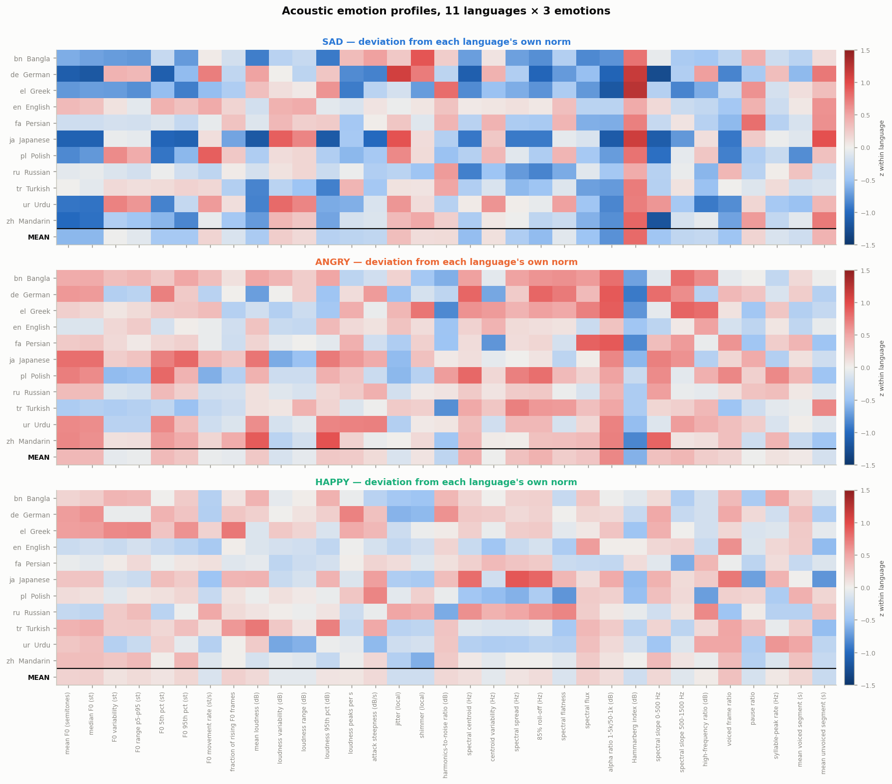
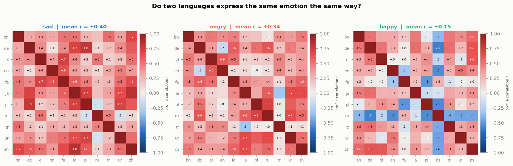
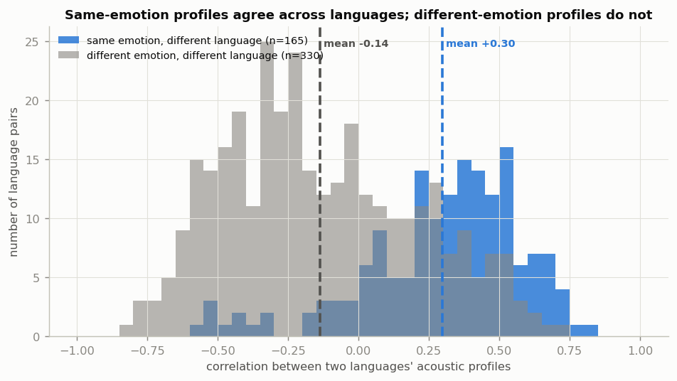
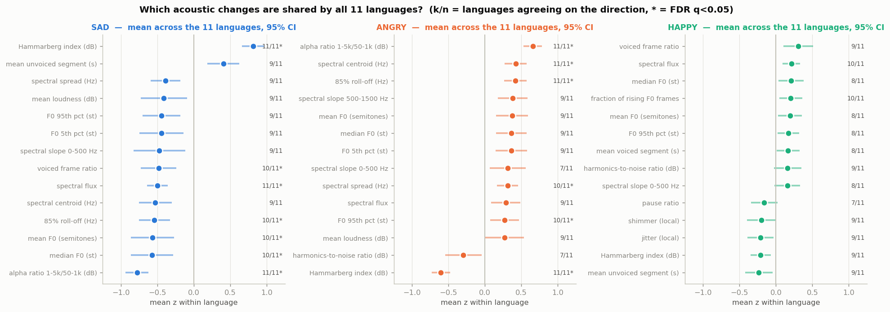
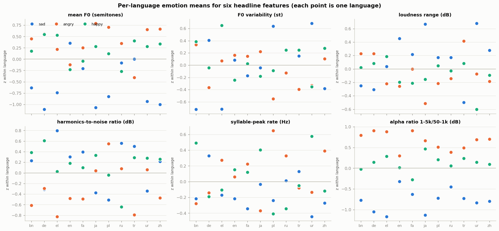
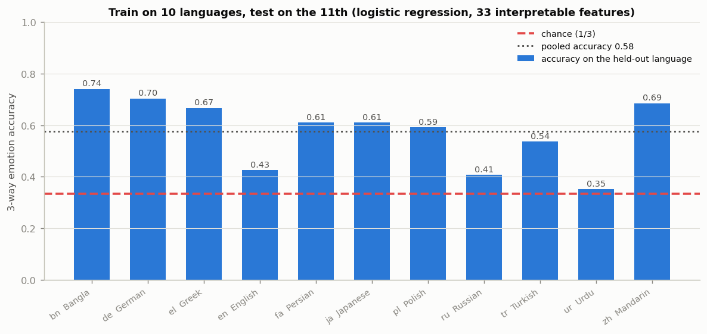
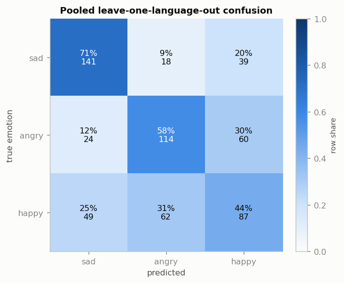
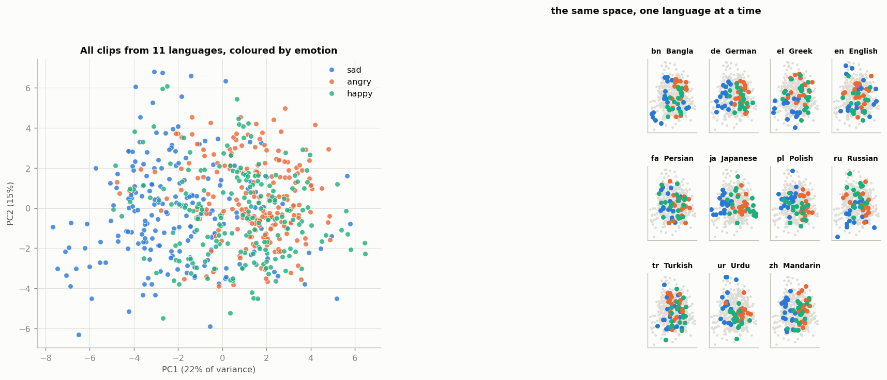
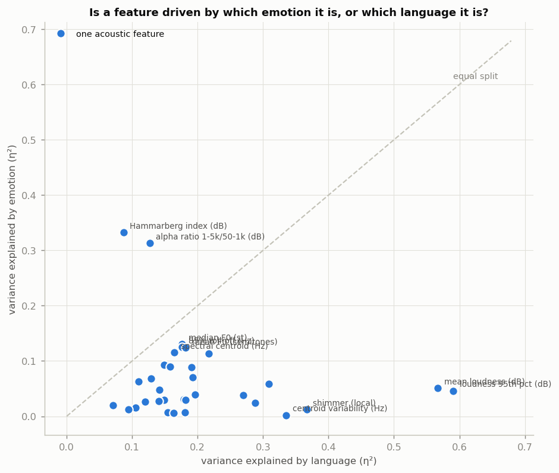

# Cross-Lingual Emotion Acoustics

Can emotional speech share acoustic patterns across languages? This experiment
compares **sad, angry, and happy** speech in 11 languages, asking whether the
acoustic changes associated with an emotion point in similar directions across
languages and whether a model trained on some languages transfers to an unseen
one.

Sadness is the anchor emotion because it approximates the original question
about crying. The recordings are corpus-labelled emotional speech, however, not
verified samples of spontaneous crying. The project is a small cross-corpus
acoustic study, not a perceptual evaluation or a claim that emotions sound
identical across cultures.

## At A Glance

| | Design |
|---|---|
| Languages | 11 across 8 language families |
| Corpora | 11 emotional-speech corpora, one per language |
| Labels | Sad, angry, happy |
| Sample | 18 clips per language and emotion; 594 clips total |
| Audio | Mono, 16 kHz, silence-trimmed, at most 12 seconds; amplitude retained |
| Features | 59 per clip: 33 interpretable acoustic features and 26 MFCC statistics |
| Main transfer test | Train on 10 languages, evaluate on the held-out language |

Languages: English, German, Greek, Polish, Russian, Persian, Urdu, Bangla,
Turkish, Mandarin, and Japanese.

## Results

The main pattern is **shared relative direction, not shared absolute sound**.
For each feature, the analysis z-scores clips within their language using that
language's sample mean and standard deviation. This makes profiles comparable
in relative terms; it does not create a neutral baseline or erase every
speaker, recording, or corpus difference.

- **Emotion profiles align across languages.** Mean profile correlation is
  `r = 0.40` for sadness (95% bootstrap CI `0.34–0.45`), `r = 0.34` for anger
  (`0.28–0.40`), and `r = 0.15` for happiness (`0.05–0.23`). Different-emotion
  profiles average `r = -0.14`. The same-versus-different comparison gives
  `p = 7.0e-33` in the analysis' Mann–Whitney test.
- **Sadness has the clearest shared feature pattern.** The Hammarberg index
  shifts up by `0.81` within-language standard deviations and the alpha ratio
  shifts down by `0.78`; all 11 languages agree on both directions. Spectral
  flux shifts down by `0.50` in all 11. Mean F0 shifts down by `0.57` in 10 of
  11 languages. The first three direction-consistency results have
  Benjamini–Hochberg `q = 0.005`.
- **Language and corpus still matter.** Across the 33 interpretable features,
  mean variance explained (`eta-squared`) is `0.20` for language and `0.07` for
  emotion. Only two features show the reverse pattern, with larger
  emotion-level than language-level eta-squared: the Hammarberg index and alpha
  ratio.
- **Cross-language classification is above chance, but imperfect.** With the
  33 interpretable features, leave-one-language-out logistic regression scores
  `57.6%` accuracy versus `33.3%` chance. Its within-language 3-fold CV
  reference is `74.4%`. A within-language label permutation test (150 runs)
  gives a `33.5%` mean null accuracy and `p = 0.0066`. The random forest scores
  `62.3%`, but it was not permutation-tested; it should not be read as having
  the same significance evidence as logistic regression.
- **The clip-level effect is modest.** Across 160,380 cross-language clip
  pairs, same-emotion clips have mean distance `7.58` versus `8.04` for
  different-emotion pairs (`AUC = 0.57`, Cohen's `d = 0.24`). The overlap is
  substantial: emotion silhouette is `0.006`.
- **The gain-invariance check preserves the main result.** Repeating the
  interpretable-feature analyses without the two level-sensitive features
  (`rms_mean_db`, `rms_p95_db`) gives same-emotion profile correlation `0.32`
  versus `-0.15` for different emotions, and leave-one-language-out logistic
  accuracy of `57.1%`.

These are patterns in this sample, not proof of universal emotional signals.
Pairwise language comparisons reuse the same languages, and each language is
represented by one corpus; interpret the reported pairwise p-values alongside
those design limits.

## Figures

The figures are generated from the saved analysis outputs by
[`scripts/05_figures.py`](scripts/05_figures.py). Read them as complementary
views: Figures 1–5 describe feature profiles, Figures 6–7 test prediction, and
Figures 8–9 show the overall feature-space structure and variance comparison.

### 1. Emotion Profiles



Rows are languages and columns are interpretable features; each emotion gets a
panel. Blue and red indicate values below and above that language's sample mean.
Use this to see whether a feature's direction repeats across languages and
which languages depart from the overall pattern.

### 2. Cross-Language Profile Correlations



Each matrix compares two languages' feature profiles for one emotion. Stronger
positive correlations mean their relative feature changes point in more similar
directions; this is profile similarity, not similarity of absolute pitch or
loudness.

### 3. Same Versus Different Emotion



This summarizes the central comparison: correlations for the same emotion in
different languages versus different emotions in different languages. The
distributions overlap, but their means are separated.

### 4. Feature Direction Consistency



Points show mean within-language shifts and bars show 95% confidence intervals
across languages. The `k/n` labels count languages agreeing on direction; an
asterisk marks a feature passing the figure's FDR threshold.

### 5. Key Features By Language



This view makes the language-level spread visible for selected headline
features. It is useful for checking whether an average effect is broad-based or
driven by a few languages.

### 6. Leave-One-Language-Out Transfer



Each language is held out in turn while models train on the other ten. Compare
languages to see where transfer is strongest or weakest; the plot reports
model performance, not a causal ranking of languages.

### 7. Confusion Matrix



Rows are true labels and columns are predictions for the pooled
leave-one-language-out logistic-regression run. This shows which emotions are
most often confused across the held-out languages.

### 8. PCA Feature-Space View



PCA projects the standardized feature vectors into two dimensions for visual
inspection. It can suggest broad structure, but it is a projection and should
not be treated as a separate significance test.

### 9. Emotion Versus Language Variance



Each point is a feature. Points above the diagonal have larger emotion-level
than language-level eta-squared; points below it show the reverse. The
Hammarberg index and alpha ratio are the two features where emotion's value is
higher in this analysis.

## Method

1. **Fetch candidate audio.** `01_fetch.py` samples up to 30 candidates per
   language/emotion cell from the registered sources.
2. **Build the clip set.** `02_build_clips.py` selects up to 18 usable clips per
   cell, spreads selections across available speaker IDs, converts to mono at
   16 kHz, trims silence, and caps duration at 12 seconds. It does not
   amplitude-normalize the audio.
3. **Extract features.** `03_extract_features.py` computes pitch, loudness,
   voice-quality, spectral, temporal, and MFCC statistics using librosa and
   Praat/parselmouth.
4. **Analyze.** `04_analyze.py` writes per-analysis CSVs and `summary.json`.
   Features are z-scored within language for profile and transfer analyses.
   Classifiers are evaluated with leave-one-language-out splits; the primary
   logistic-regression permutation test shuffles emotion labels within each
   language.
5. **Visualize and report.** `05_figures.py` creates the nine PNGs;
   `06_report.py` builds the standalone HTML report from the saved results.

The analysis script covers:

| Analysis | Question |
|---|---|
| A | What is each language's mean feature profile for each emotion? |
| B | Are same-emotion profiles more correlated across languages than different-emotion profiles? |
| C | Which features shift in a consistent direction across languages? (binomial tests with FDR correction) |
| D | How do emotion-level and language-level eta-squared compare by feature? |
| E | How well do emotion classifiers generalize to a language left out of training? |
| F | Are clips closer to cross-language clips with the same emotion? |
| G | How predictable is language identity before and after within-language standardization? |
| H | Do profile and transfer results persist after dropping level-sensitive features? |

## Reproduce

The scripts need Python 3, internet access for fetching source files, and `curl`
on the system path. From the repository root:

```bash
python3 -m venv .venv
source .venv/bin/activate
python -m pip install librosa soundfile praat-parselmouth scikit-learn scipy pandas matplotlib huggingface_hub

python scripts/01_fetch.py
python scripts/02_build_clips.py
python scripts/03_extract_features.py
python scripts/04_analyze.py
python scripts/05_figures.py
python scripts/06_report.py
```

The fetch and clip-building stages accept `--only en,de` to process selected
languages. Downloads already present on disk are skipped. Feature extraction
and analysis run on the full manifest. The analysis includes 150 logistic
permutation runs and can take longer than the data-preparation stages.

For a quick look at the completed findings, open [`REPORT.md`](REPORT.md) or
the self-contained [`report.html`](report.html). The main machine-readable
outputs are `features/manifest.csv`, `features/features.csv`,
`features/features_zlang.csv`, `results/*.csv`, and `results/summary.json`.

## Project Files

```text
scripts/
  config.py              corpus registry, label mapping, and sampling settings
  feature_defs.py         feature names, groups, display labels, and sensitivity
  01_fetch.py             download candidate audio
  02_build_clips.py       select and standardize clips; write manifest
  03_extract_features.py  extract acoustic features
  04_analyze.py           run analyses A–H and write result tables
  05_figures.py           generate figures 1–9
  06_report.py            build the standalone HTML report
data/raw/                 downloaded source audio and candidate manifests
data/clips/               standardized clips used in the analysis
features/                 clip manifest and raw/standardized feature tables
results/                  analysis CSVs and summary.json
figures/                  PNG figures shown above
logs/                     stage logs
```

## Corpora And Data Use

| Language | Corpus | Use/licence recorded in `scripts/config.py` |
|---|---|---|
| English | RAVDESS | CC BY-NC-SA 4.0 |
| German | EmoDB | Free for research |
| Greek | AESDD | Research use |
| Polish | nEMO | CC BY-NC-SA 4.0 |
| Russian | RESD | MIT |
| Persian | ShEMO | Research use |
| Bangla | SUBESCO | CC BY 4.0 |
| Japanese | JVNV | CC BY-SA 4.0 |
| Mandarin | CASIA | Research use |
| Urdu | URDU-Dataset | Research use |
| Turkish | TurEV-DB | Research use |

The corpus references are also recorded alongside these fields in
[`scripts/config.py`](scripts/config.py). These are source-specific terms, not
a blanket licence for this project. Check each corpus's current terms and
citation requirements before redistributing source audio or derived clips.
This repository does not grant rights to the underlying recordings.

## Limitations

- Each language is represented by one corpus, so language and corpus effects
  cannot be cleanly separated. Within-language standardization and the
  gain-invariance repeat reduce some scale differences; they do not remove this
  confound.
- The labels come from emotional-speech corpora. Sad speech is not necessarily
  spontaneous crying, and no listener study verifies the emotion labels.
- Speaker IDs are unavailable or incomplete in some corpora, limiting speaker
  balancing and leaving speaker variation partly confounded with emotion.
- Eighteen clips per cell is a small sample. Language-level estimates can be
  sensitive to the sampled speakers and recording conditions.
- Pairwise profile correlations share languages, so those comparisons are not
  independent observations. Interpret their p-values with the study design in
  mind.
- The current feature set captures acoustic correlates, not linguistic
  meaning, facial cues, or all cultural conventions for expressing emotion.
